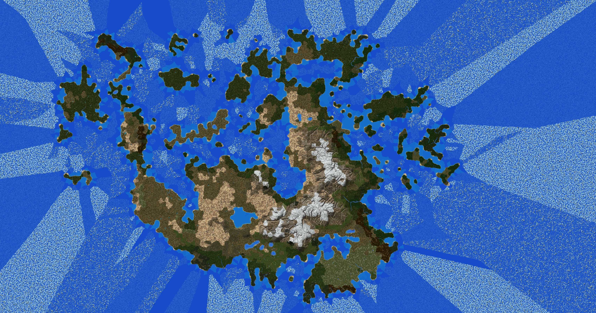
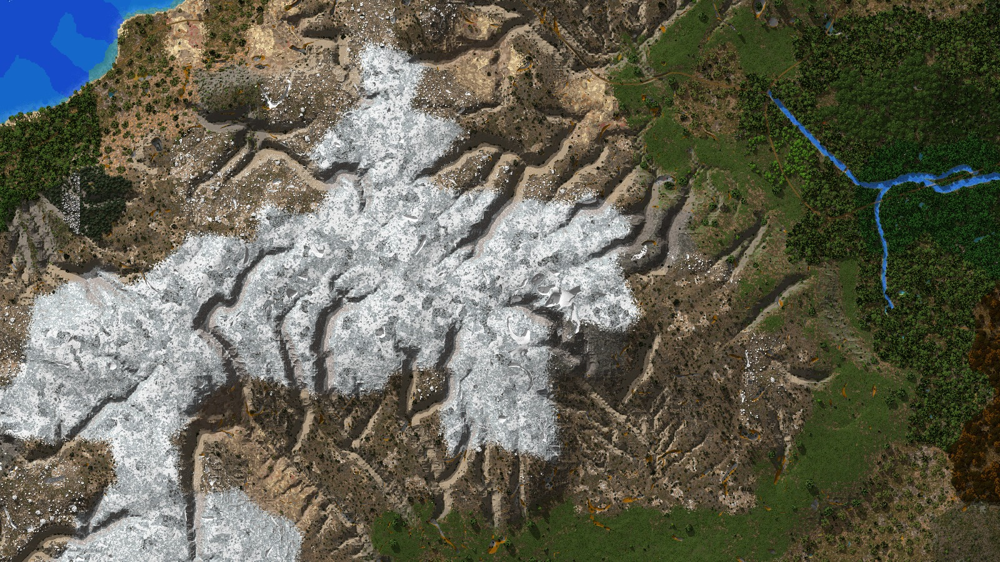
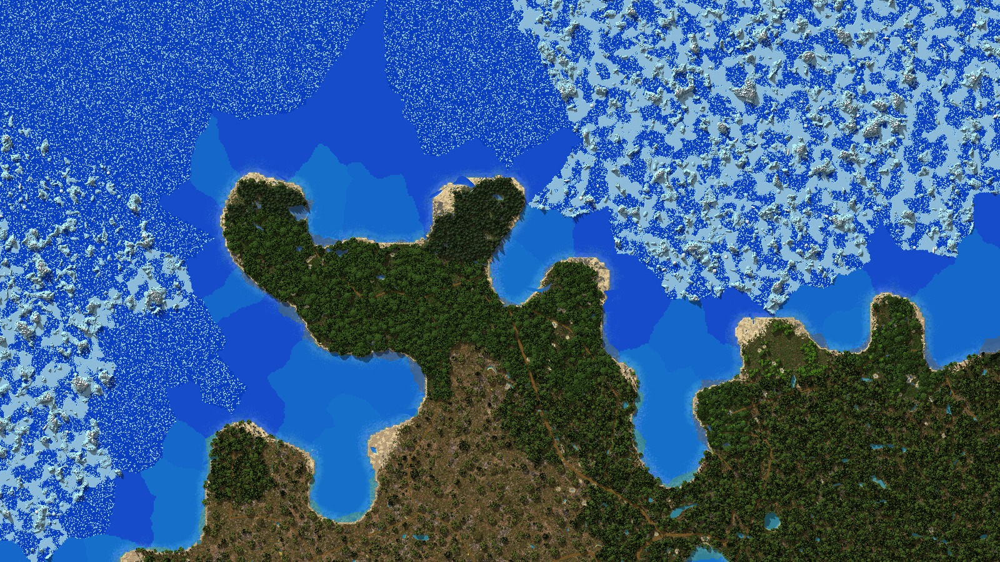
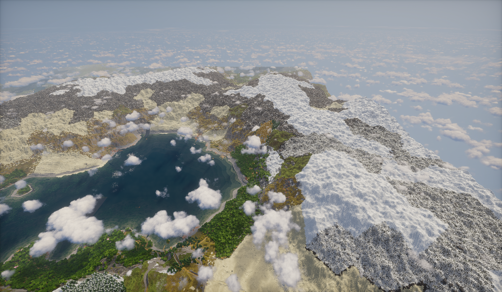
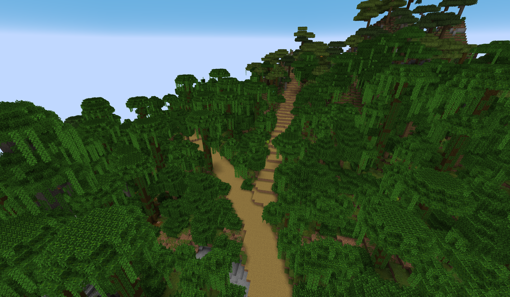
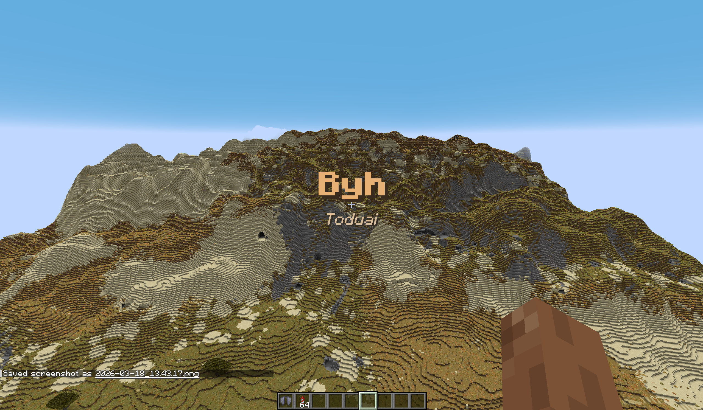
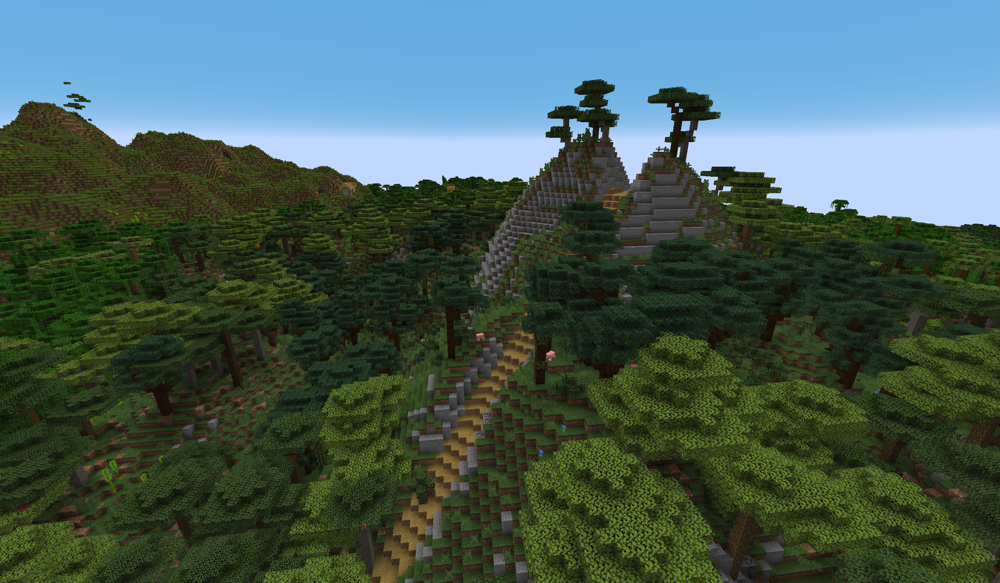
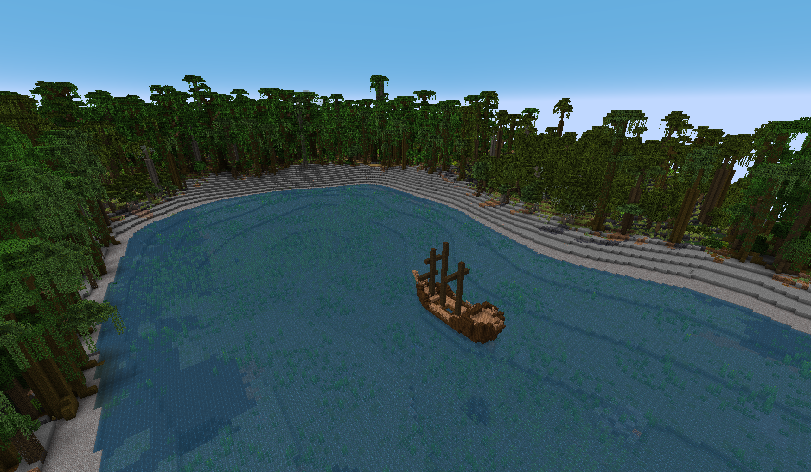

# Fantasy Map Generator (Fabric)

A fabric mod to generate a Minecraft overworld from a **Fantasy Map Generator (FMG)** JSON export from Azgaars fantasy map generator.

- **Minecraft**: 1.20.1 -- this is the Conquest Reforged branch. The vanilla
  version lives on the `1.21.4` branch.
- **Mod loader**: Fabric (`fabricloader >= 0.18.4`)
- **Requires**: Fabric API
- **Optional**: [Conquest Reforged](https://www.curseforge.com/minecraft/mc-mods/conquest-reforged)
  (Fabric, 1.20.1). With it installed the create-world screen offers a
  "Conquest Reforged" content option: 29 Conquest biomes and a ground built
  from Conquest layer blocks. See `docs/conquest/palettes.md`.
- **Java**: 17+

---

## Gallery

### FMG overview (zoomable)

This is an **HD/partial-load** FMG view so you can zoom in and see the paths + biome layout clearly (a “what this will look like in a full world” preview).


### Generated world (Conquest Reforged)

The full Granesia map generated as a 27,000 x 14,000 block world (about 1.5 million chunks,
pregenerated with Chunky) and rendered with [uNmINeD](https://unmined.net/). uNmINeD
does not know Conquest blocks; `tools/fmgtrees/unmined_config.py` writes the uNmINeD
config files that give every Conquest block its in-game colour.



[Full resolution, 1 pixel = 4 blocks (6824 x 3588, 14 MB)](images/granesia_world_map_full.jpg)




### In-game screenshots







### Map examples (less detailed)

These are additional map examples (less detailed than the HD overview above), useful to illustrate different layouts.


## Install (Singleplayer)

1. Install **Fabric Loader** for Minecraft **1.20.1**.
2. Download/install **Fabric API**.
3. Put this mod’s `.jar` in your `.minecraft/mods` folder.
4. Launch the game once (this creates the config file).

---

I would highly recommend installing william wythers overhauled overworld as well https://modrinth.com/mod/wwoo/ as it introduces better biome blending/shading and good looking sub biomes as well, using this generation mod without it makes the biomes look off. Even if you use both the game stays perfectly vanilla block and item wise.
## Quickstart: play on your FMG map

### 1) Export your map from FMG

From Fantasy Map Generator, export a **Full JSON** (the same kind of export that contains states/provinces/biomes/burgs).

Put the exported `.json` file somewhere inside your Minecraft instance folder (recommended):

- `.minecraft/config/fantasymapgenerator/YourMap.json`


### 2) Point the mod to your JSON export

After first launch, edit:

- `.minecraft/config/fantasymapgenerator/config.json`

Set `mapJsonPath` to your export.
sampleScale is an adjustable value for the map scale
Example:

```json
{
  "mapJsonPath": "C:/Users/ExampleUser/Downloads/YourMap.json",
  "sampleScale": 12.0
}
```
Mind the directino of the slashes, it has to be forward slashes.

Restart Minecraft after changing the file.

### 3) Create a new world using the preset

Create a new singleplayer world and select the **“Fantasy Map”** world preset.

- The mod ships a built-in datapack/resource pack that adds this preset.
- Nether and End remain vanilla; only the Overworld is replaced.


NOTE: generating can take a while
---


## Implemented features

Current functionality in this template:
- **togglable borders** typing /fmg borders enables a client side render of the province borders.
- **Custom Overworld preset** (“Fantasy Map”) that uses FMG-backed worldgen.
- **FMG-backed terrain height**: surface elevation is projected from the FMG export instead of vanilla noise.
- **FMG-backed biome selection**: surface biomes are chosen from FMG map data.
- **Burg-based villages**: a custom structure places jigsaw villages at FMG **burg** locations (with a flatness check, this does mean some burgs do not spawn).
- **Structures in custom biomes**: each custom biome (the Conquest set) names the vanilla biomes it stands in for (`biomes.structureStandIns` in `config/fantasymapgenerator/profiles/conquest.json`), so vanilla structures and structure mods that target vanilla biomes also generate in it.
- **Region title popups**: when a player crosses into a different **state/province**, the mod shows a title + subtitle.
- **Configurable map path override** via `config/fantasymapgenerator/config.json`.

Missing functionality:
- **Rivers** 
- **1.18 noise caves instead of just spaghetti caves**
---


## Troubleshooting

- **World creation crashes or says it can’t find the FMG export**:
  - Make sure the file exists at the path in `mapJsonPath`.
  - If using a relative path, it is resolved relative to the **Minecraft instance directory** (usually `.minecraft/`).
  - Restart Minecraft after changing the config.

- **No region titles show up**:
  - Region titles only appear in dimensions using the FMG chunk generator (the “Fantasy Map” preset overworld).


## Credits

The Conquest Reforged content variant is built on other people's work. Worldgen
now places this project's own trees, made with TreeGenerator; earlier versions
used the tree packs below, converted locally to Conquest blocks. **None of them
is redistributed in this repository**, and nothing third-party ends up in the
jar. If you want any of these assets, get them from the original author.

### Tree models

| Pack | Author | Where |
|---|---|---|
| Regional tree packs (Africa, eastern North America, temperate Asia, South and Southeast Asia, South America, Florida/Caribbean) -- 1272 schematics | **paleozoey** | [profile](https://www.planetminecraft.com/member/paleozoey/), bundled with [Arnis](https://github.com/louis-e/arnis) by louis-e (Apache-2.0) |
| QF Tree Repository -- 874 WorldEdit schematics, already built from Conquest blocks | **quitefrank_ly** | [profile](https://www.planetminecraft.com/member/quitefrank_ly) / [project](https://www.planetminecraft.com/project/conquest-reforged-larch-tree-bundle/) |
| Axiom blueprint tree pack -- 440 blueprints, 30 species | **squarishbinkie** | credited in the blueprint `Author` field |
| Ultimate Bush and Shrubs Pack for Conquest Reforged | see project page | [project](https://www.planetminecraft.com/project/ultimate-bush-and-shrubs-pack-for-conquest-reforged/) |

**The QF Tree Repository readme asks specifically**, and it is worth repeating
in full:

> Feel free to use this for any of your projects, but make sure to provide a
> link back to this page or my profile. Do not redistribute, but instead provide
> a link to this page or my profile. Do not use for commercial purposes.
>
> -- quitefrank_ly

That is why the converted trees never went into `src/main/resources` or git.
The same courtesy is extended to the other three packs.

### Blocks and textures

- **[Conquest Reforged](https://www.conquestreforged.com/)** -- the block set
  everything here is remapped onto. Mod id `conquest`.
- **ACRP (ArdaCraft Resource Pack)** -- the vanilla-block textures the converted
  trees assume, by the [ArdaCraft](https://ardacraft.me/) team.

### The map generator itself

- **[Azgaar's Fantasy Map Generator](https://azgaar.github.io/Fantasy-Map-Generator/)**
  by Azgaar -- the map format this mod reads, and the reason it exists.

The artistry in those tree models is entirely the authors' above.


## License

See `LICENSE`. This covers the code in this repository only -- the tree packs,
Conquest Reforged and ACRP are each under their own terms, listed under
**Credits**.
